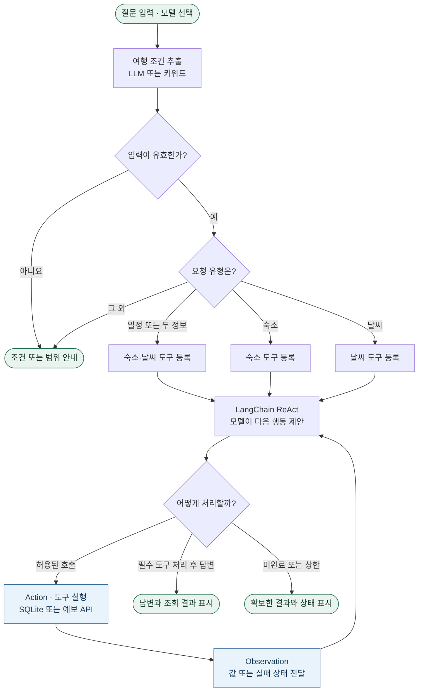

# 프로그램 설계

## 활동 다이어그램

[활동 다이어그램 PNG 열기](activity_diagram.png)

CoT 수업의 조건 파악 단계에서는 여행 질문을 짧은 구조화 데이터로 바꿉니다. ReAct 단계에서는 모델이 `Action`으로 도구를 요청하고, LangChain이 함수를 실행한 뒤 `Observation`을 다음 모델 호출에 전달합니다. 화면에는 추출한 조건, 실제 호출 및 반환 상태, 추천 이유를 보여줍니다. [LangChain 에이전트 문서](https://docs.langchain.com/oss/python/langchain/agents)

## 모듈 구성

| 모듈 | 책임 | 연결 대상 |
| --- | --- | --- |
| `app.py` | 질문 입력, 모델 선택, 일정 카드·숙소 목록·7일 예보 표 표시 | `agent.py` |
| `intent.py` | 한국어 질문에서 `TripIntent` 추출, 도시·날짜·예산 검증 | 선택한 LLM 또는 데모의 키워드 규칙 |
| `agent.py` | 도구 허용 목록 적용, LangChain 실행, 관찰값과 추천 결과 반환 | `intent.py`, `data.py`, OpenAI 또는 Gemini |
| `data.py` | 숙소·예보 도구 구현, 응답을 공통 형식으로 변환 | SQLite, Open-Meteo, 선택형 TourAPI |

Streamlit은 표시와 입력을 맡고 도구 정책은 에이전트에서 관리합니다. DB나 API의 응답 형식이 바뀌면 데이터 모듈에서 변환을 수정합니다. 예보 표와 숙소 목록은 도구 반환값으로 직접 채우고, 모델은 코스를 설명하는 역할을 맡습니다.

## 입력과 도구 계약

| 인터페이스 | 입력 | 반환 |
| --- | --- | --- |
| `TripIntent` | 자연어 질문과 한국시간 기준 날짜 | `task`, `city`, `start_date`, `days`, `max_nightly_krw`, `preference` |
| `search_stays` | 검증한 도시, 1박 예산 또는 미지정 | 숙소 ID·이름·권역·가격(없으면 `null`)·출처, 조회 상태 |
| `get_weather` | 검증한 도시의 대표 위도·경도 | 오늘부터 7개 날짜별 날씨·최저/최고 기온(°C)·최대 강수확률(%)·PM10/PM2.5(µg/m³)·조회 상태 |
| `TripResult` | 의도, 도구 반환값, 최종 답변 | 날짜별 경로와 근거, 숙소 후보, 예보 표, 호출 기록과 상태 |

도구는 `TripIntent`에서 검증한 도시와 예산으로 실행합니다. 같은 요청 중 동일한 조회가 반복되면 최초 결과를 재사용합니다. 도구 반환에는 `성공`, `결과 없음`, `일부 성공`, `실패` 상태를 담습니다. 모델이 필수 도구를 호출하기 전에 답변을 끝내거나 ReAct에서 모델을 4회 호출하고도 답변을 완료하지 못하면, 확보한 결과와 미완료 안내를 표시합니다. 의도 추출에 쓰는 별도 호출은 이 횟수에서 제외합니다.

## 데이터 출처

- **숙소**. SQLite `stays`에 ID, 도시, 권역, 이름, 1박 가격, 출처를 저장하고 도시·예산으로 조회합니다. 첫 버전은 수업용 숙소 DB로 실행합니다. TourAPI 키가 설정되면 한국관광공사의 숙박 목록 `searchStay2`에서 받은 이름·주소 등을 SQLite에 반영하고 같은 검색 함수를 사용합니다. 가격이 확인되지 않은 항목은 예산 충족 후보에 넣지 않습니다. 조회가 실패하면 저장된 후보와 출처를 표시합니다. [한국관광공사 국문 관광정보 서비스](https://www.data.go.kr/data/15101578/openapi.do)
- **날씨와 대기질**. Open-Meteo의 날씨 API에서 7일 일별 데이터를 받고, Air Quality API의 시간별 PM 값을 한국시간 날짜로 묶어 일평균을 냅니다. 대기질 예보 기간은 실제 반환 범위를 따릅니다. 두 API 중 하나가 실패해도 다른 API의 결과를 표시합니다. [날씨 API](https://open-meteo.com/en/docs), [Open-Meteo 대기질 API와 CAMS 출처](https://open-meteo.com/en/docs/air-quality-api)
- **관광지**. 도시별 소규모 목록을 준비합니다. 장소마다 `id`, 이름, 권역, 실내·야외 유형을 두고 모델에 전달합니다. 모델은 이 목록의 장소를 이용해 숙소 기준 방문 순서를 제안합니다.

## 구현 순서

1. **도구부터 개발**. SQLite 예제 데이터와 관광지 목록을 만들고, 숙소 검색과 7일 예보 병합을 각각 확인합니다.
2. **의도와 ReAct 연결**. 요청 유형별 도구를 등록하고 수업 데모로 `Action → Observation → Final`을 검증한 뒤, OpenAI와 Gemini 어댑터를 연결합니다.
3. **화면과 예외 처리 검증**. 일정 카드, 숙소 후보, 7일 표, 호출 기록을 배치하고 [인수 테스트](01_요구사항_및_검증.md#인수-테스트)를 실행합니다. TourAPI 키가 준비되면 숙소 목록을 가져오는 경로도 확인합니다.
