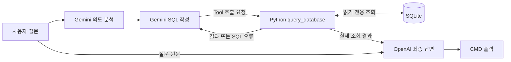

# Gemini SQL 조회와 OpenAI 답변 MVP

Gemini가 질문의 의도와 조회 기간을 파악하고, 질문과 DB 스키마에 맞춰 SQL을 작성합니다. Python이 읽기 전용 SQLite 도구를 실행하고, OpenAI가 사용자 원문과 실제 조회 결과로 답변을 작성합니다.

## 프로젝트 구성

| 파일 | 역할 |
| --- | --- |
| [main.py](main.py) | CMD 진입점, 공통 모델 인터페이스, Tool 호출 루프, 최종 답변 생성 |
| [intent_analysis.py](intent_analysis.py) | Gemini 의도 분석, 대상·기간 검증, 상대 기간 보정 |
| [custom_tools.py](custom_tools.py) | SQLite 생성 및 조회, SQL 실행 제한, Tool 등록 |
| [requirements.txt](requirements.txt) | 설치할 라이브러리의 버전 |
| [company.sqlite3](company.sqlite3) | 가상 직원 100명과 법인카드 거래 1,000건 |
| [index.html](index.html) | 질문, 최종 답변, 실행 SQL을 확인하는 로컬 웹 화면 |
| `.env` | 이 폴더에 직접 만드는 로컬 API 키·모델 설정 파일 |
| `test_*.py`, `*_report.json` | 오프라인 회귀 테스트와 이전 API 검증 기록 |

이 문서는 `agent_orchestration_mvp_261119`의 `company.sqlite3`와 동적 SQL 구현을 설명합니다. 실행용 Python 소스는 위의 세 파일입니다.

## 실행 흐름



1. `analyze_intent()`가 Gemini의 구조화 응답을 검증해 의도, 대상, 기간, 조건을 정리합니다. 대상이나 기간이 불명확하면 확인 질문을 출력합니다.
2. 조회가 필요하면 `AgentClient.run_with_tools()`가 원문, 검증된 의도, `DATABASE_SCHEMA`를 Gemini에 전달합니다. Gemini는 네이티브 Tool Calling으로 `query_database`에 SQL과 바인딩 값을 전달합니다.
3. `execute_tool()`이 Tool 이름과 인수를 검증하고 `query_database()`를 실행합니다. Python이 실행 결과를 같은 호출 ID로 Gemini에 돌려주므로, Gemini가 필요한 경우 추가 조회하거나 SQL을 수정할 수 있습니다.
4. `generate_final_answer()`가 질문 원문, 의도, 실제 SQLite 결과를 OpenAI에 전달합니다. OpenAI는 이 결과로 표·요약·비교 등 요청한 형식의 답변을 작성합니다.

일반 지식 질문은 의도 분석 후 OpenAI 답변으로 바로 이어집니다. 조회 결과에서 동명이인처럼 대상을 다시 확인해야 할 경우 확인 질문과 조회 기록을 출력합니다. 마지막 Tool 라운드에 오류가 남아 있거나 Gemini가 조회 미완료를 반환하면 조회 단계에서 종료합니다.

## 기술 스택과 핵심 함수

목표 환경은 **Windows CMD + Python 3.13 + `venv`**입니다. Python 표준 라이브러리 `sqlite3`로 파일 DB를 사용하므로 별도 DB 서버 설치가 필요 없습니다.

| 라이브러리 | 버전 | 주요 호출 |
| --- | --- | --- |
| `openai` | `3.52.0` | `OpenAI(...)`로 두 제공사 연결. Gemini는 `client.chat.completions.create(...)`, OpenAI는 `client.responses.create(...)` |
| `python-dotenv` | `1.2.4` | `load_dotenv(...)`로 프로젝트 폴더의 `.env` 로딩 |
| `pydantic` | `2.14.3` | `model_json_schema()`로 구조화 응답 명세 생성, `model_validate_json()`으로 Gemini 응답 검증 |
| Python 표준 라이브러리 | Python에 포함 | `sqlite3`로 SQL 실행, `argparse`로 CMD 옵션 처리, `json`으로 모델·Tool 데이터 전달, `datetime`·`calendar`로 기간 계산, `unittest`로 테스트 |

| 위치 | 함수·클래스 | 역할 |
| --- | --- | --- |
| `main.py` | `load_settings()`, `create_agents()` | `.env`와 환경 변수 로딩, 요청 제한 및 제공사별 키·모델 검증, SDK 클라이언트 생성 |
| `main.py` | `AgentClient.generate()` | Gemini의 `messages`와 OpenAI의 `input`·`instructions` 차이를 공통 인터페이스에서 처리 |
| `main.py` | `run_pipeline()`, `AgentClient.run_with_tools()` | 모델 간 전달과 Tool 실행 순서 제어, Tool 호출 ID와 조회 기록 보관 |
| `main.py` | `generate_final_answer()` | 원문과 실제 DB 조회 결과로 최종 답변 요청 |
| `intent_analysis.py` | `analyze_intent()`, `relative_period_rules()` | Gemini 결과 검증, 원문에 있는 식별자 확인, 등록된 상대 기간 보정 |
| `custom_tools.py` | `execute_tool()`, `query_database()`, `_authorize()` | 등록된 함수 호출, SQL 바인딩, SQLite 조회 범위 제한 |
| `custom_tools.py` | `initialize_database()` | DB 최초 생성과 테스트 데이터 적재 |

사용자 정의 Tool을 추가하거나 교체할 때는 `custom_tools.py`에서 함수, 입력 명세인 `TOOL_DEFINITIONS`, 실행 함수 연결인 `TOOL_REGISTRY`를 함께 수정합니다. DB 스키마가 바뀌면 `DATABASE_SCHEMA`도 갱신해야 Gemini가 올바른 열과 조인 키를 사용합니다.

## 데이터와 SQL 실행 범위

| 테이블 | 행 수 | 주요 열 |
| --- | ---: | --- |
| `employees` | 100 | `employee_id`, `name`, `hire_date`, `department`, `annual_salary_krw`, `evaluation`(S/A/B/C/D), `job_title`, `corporate_card_id` |
| `card_transactions` | 1,000 | `transaction_id`, `corporate_card_id`, `used_at`, `merchant`, `category`, `amount_krw`, `description` |

두 테이블은 `corporate_card_id`로 연결됩니다. 날짜는 `YYYY-MM-DD`, 금액은 원(KRW) 단위 정수입니다. `company.sqlite3`의 예제 거래 기간은 **2026-08-22~2026-11-19**입니다. ERP 거래는 이 SQLite 테이블에서 모의합니다. `--init-db`는 기존 행이 들어 있으면 다시 적재하지 않습니다.

**사용자 질문의 조회 SQL은 Gemini가 생성합니다.** 공개 조회 Tool은 `query_database(sql, parameters=None, row_limit=200)` 하나입니다. 테이블 생성, 시드 입력, 적재 확인에 쓰이는 SQL은 DB 준비 단계에 속합니다.

- `sqlite3.connect(..., uri=True)`의 `mode=ro`와 `set_authorizer()`로 두 테이블 읽기를 허용하고, 데이터 수정, 스키마 변경, `ATTACH`, `PRAGMA` 등을 차단합니다.
- `connection.execute(sql, parameters)`는 한 문장을 실행합니다. 값은 `?`에 바인딩하고, 숫자는 JSON 숫자로 전달합니다.
- Tool 응답의 기본·최대 행 수는 200행입니다. 열 이름과 반환 행에는 약 64 KiB의 용량 예산도 적용합니다. 잘린 결과는 `truncated: true`와 `truncated_by`(`row_limit` 또는 `result_size`)로 표시합니다. 합계와 순위는 SQL에서 집계합니다.
- SQL 입력은 최대 32 KiB입니다. 바인딩은 문자열, SQLite 범위의 정수, 유한한 실수, `null`을 지원합니다. 결과 열의 별칭은 대소문자를 무시하고 비교합니다.
- `set_progress_handler()`가 SQLite VM 명령 1,000개마다 약 2초의 실행 예산을 점검합니다. Gemini Tool 라운드 기본값은 3회입니다.

## 월말과 상대 기간

기본 기준일은 한국 시간의 오늘입니다. `--reference-date YYYY-MM-DD`를 지정하면 같은 기준일로 예제를 재현할 수 있습니다.

| 질문 표현 | 적용 기준 |
| --- | --- |
| 이번 달 | 1일부터 `calendar.monthrange(연도, 월)`로 계산한 말일까지. 2026년 11월은 30일, 12월은 31일, 2027년 2월은 28일, 2028년 2월은 29일 |
| 지난달 | 이번 달 1일에서 하루를 뺀 날짜가 지난달 말일. 1월에서 이전 해 12월로 넘어가는 경우도 처리 |
| 이번 달 현재까지 | 등록된 상대 기간이라면 종료일을 기준일까지만 적용. 기준일이 2026-11-19이면 11월 1~19일 |
| 2028년 2월, 2028-02, 2월 | 단일 월로 인식된 경우 Python이 정확한 월말을 계산. 연도가 없으면 기준일의 연도 사용 |
| 최근 7일 | 기준일 포함 7일. 기준일이 2026-11-19이면 11월 13~19일 |
| 기간 미지정 | 전체 거래 기간. “최근”처럼 범위를 확정할 수 없으면 확인 질문 |

날짜가 포함된 기간이나 여러 기간 비교는 Gemini가 해석하고 Python이 날짜 형식과 순서를 검사합니다. 단일 월이 날짜나 범위의 일부인 경우 Python의 월말 보정을 건너뜁니다. 계산된 월말과 DB에 실제 거래가 적재된 마지막 날짜는 각각 조회 기간과 데이터 범위를 나타냅니다.

## Windows CMD에서 시작하기

저장소 루트에서 기존 가상환경을 활성화합니다. 가상환경 폴더명이 `venv`라면 `.venv` 대신 `venv`를 사용합니다.

```cmd
cd /d C:\AIO_04_kjun_02
.venv\Scripts\activate.bat
python --version
cd agent_orchestration_mvp_261119
python -m pip install -r requirements.txt
```

Python 3.13과 Windows Python 런처가 설치된 환경에서 새 가상환경이 필요하면 저장소 루트에서 `py -3.13 -m venv venv`를 실행합니다.

### 모델 설정

프로젝트 폴더의 `.env`에 사용할 키와 모델 ID를 입력합니다. 이미 CMD나 시스템에 설정된 환경 변수가 우선합니다.

```dotenv
GEMINI_API_KEY=your_gemini_api_key
GEMINI_MODEL=your_available_gemini_model
OPENAI_API_KEY=your_openai_api_key
OPENAI_MODEL=your_available_openai_model
```

| 선택 설정 | 기본값 |
| --- | --- |
| `GEMINI_API_KIND`, `GEMINI_BASE_URL` | `chat_completions`, `https://generativelanguage.googleapis.com/v1beta/openai/` |
| `OPENAI_API_KIND`, `OPENAI_BASE_URL` | `responses`, `https://api.openai.com/v1` |
| `REQUEST_TIMEOUT_SECONDS` | `60`초 |
| `API_MAX_RETRIES` | `1`회. `0`~`3`으로 설정 |
| `MAX_TOOL_ROUNDS` | `3`회 |
| `SQLITE_DB_PATH` | `company.sqlite3`. 상대 경로는 프로젝트 폴더 기준 |

### 로컬 HTML 조회 콘솔

프로젝트 폴더에서 아래 명령을 실행한 뒤 브라우저에서 [로컬 조회 콘솔](http://127.0.0.1:8765)을 엽니다.

```cmd
python -X utf8 main.py --web
```

첫 화면에는 저장된 예제 응답이 표시됩니다. 질문을 제출하면 같은 Gemini → SQLite → OpenAI 파이프라인이 실행됩니다. **실행 SQL과 결과**를 펼치면 조회 쿼리, 바인딩 값, 반환 데이터를 볼 수 있습니다. 서버를 종료하려면 CMD에서 `Ctrl+C`를 누르세요.

프로젝트 폴더에 `.env`가 없다면 `--env-file 경로`로 기존 설정 파일을 지정할 수 있습니다. 기본 접속 주소는 현재 컴퓨터의 `127.0.0.1:8765`이며, 포트를 바꾸려면 `--port`를 사용하세요.

### CMD에서 질문하기와 조회 확인

```cmd
python -X utf8 custom_tools.py --init-db
python -X utf8 main.py
python -X utf8 main.py --question "김가온의 이번 달 법인카드 사용 건수와 총액을 표로 알려줘" --reference-date 2026-11-19 --json
```

`main.py`만 실행하면 `질문:`에서 한 건을 직접 입력할 수 있습니다. 기본 출력은 최종 답변입니다. `--instructions "표로 답해주세요"`로 출력 형식을 지정할 수 있습니다. `--json`을 사용하면 아래 정보가 함께 출력됩니다.

| 확인 항목 | 출력 필드 |
| --- | --- |
| Gemini가 해석한 대상·기간·조건 | `intent.analysis` |
| 실제 SQL과 바인딩 값 | `tool_trace[].arguments` 안의 `sql`, `parameters` |
| SQLite가 반환한 행과 잘림 여부 | `tool_trace[].result`의 `data.rows`, `data.truncated` |
| 최종 답변과 OpenAI 요청 여부 | `answer`, `answer_generator`, `openai_called` |
| 전체 처리 결과와 오류 정보 | `status`, `error` |

오류가 나면 `status`와 `error.stage`로 의도 분석(`intent_analysis_failed`), 조회(`retrieval_failed`), 최종 답변(`answer_generation_failed`) 중 어느 단계에서 실패했는지 확인할 수 있습니다. `error.provider`와 `error.http_status`에는 해당 제공사와 HTTP 상태가 표시됩니다. HTTP 503 등 일시적인 API 오류에는 SDK의 제한된 재시도가 적용됩니다.

## 검증

아래 명령은 프로젝트 폴더에서 실행합니다.

```cmd
python -X utf8 -m unittest discover -s . -p "test_*.py" -v
python -X utf8 custom_tools.py --sql "SELECT department, COUNT(*) AS employee_count FROM employees GROUP BY department"
python -X utf8 main.py --analyze-intent --question "E001의 이번 달 카드 사용액" --reference-date 2026-11-19
python -X utf8 main.py --test-intents --reference-date 2026-11-19
```

- `unittest`와 `--sql`은 모델 API를 호출하지 않습니다. 오프라인 테스트는 SQL 읽기 제한, 인수와 결과 검증, 월말·윤년, Gemini → SQLite → OpenAI 호출 순서, 조회 오류 복구와 확인 질문을 검증합니다. **현재 작업 공간의 Python 3.12.10 가상환경에서 56개가 통과**했습니다. 목표 환경인 Python 3.13에서는 별도 실행 확인이 필요합니다.
- `--analyze-intent`는 Gemini로 질문 한 건을 분석하고, `--test-intents`는 내장 질문 8건을 검증합니다.
- [동적 SQL 검증 보고서](dynamic_sql_test_report.json)에는 직원 ID 조회, 이름 기반 카드 집계, 부서별 지출 순위의 이전 실제 API 검증 **3건**이 기록되어 있습니다. 이번 변경 후에는 김가온의 2026년 11월 법인카드 사용 건수와 총액을 실제 API로 다시 검증했습니다. OpenAI의 **3건, 423,500원**과 독립 SQLite 집계가 일치했습니다.
